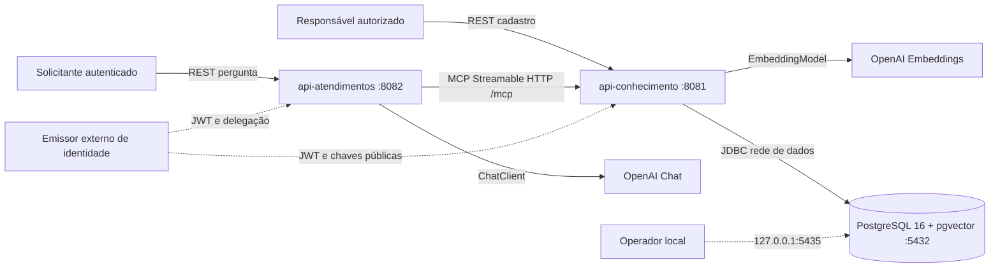
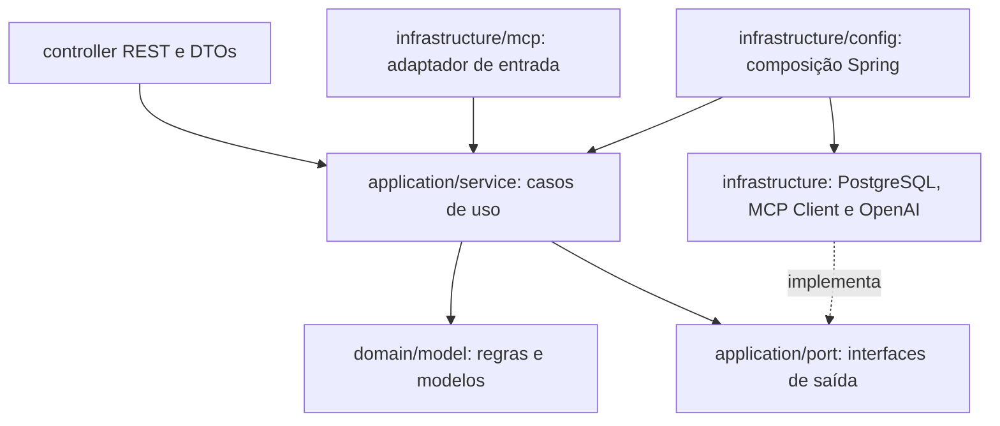
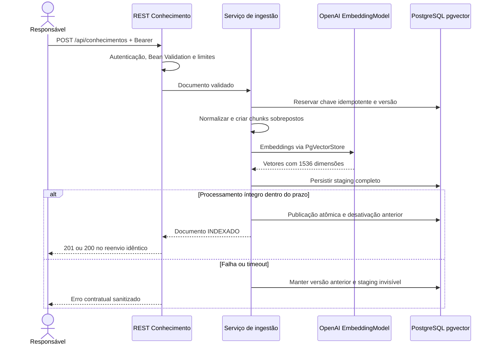
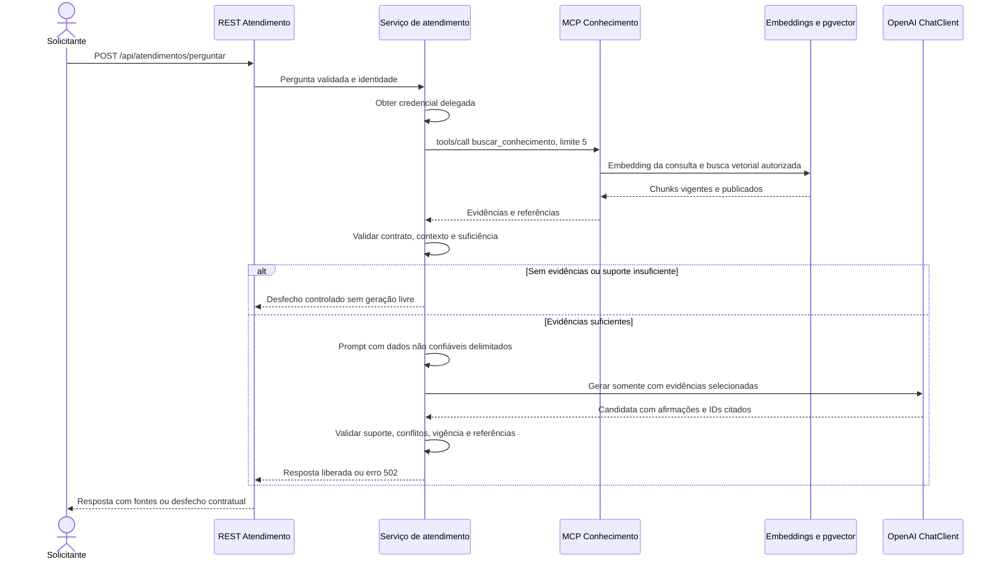

# Arquitetura do MVP — COTI AI Atendimento

## 1. Estado, autoridade e escopo

Baseline arquitetural definida em 28/10/2026. Este documento fixa as fronteiras e decisões do MVP; não constitui evidência de implementação, compilação ou testes. A constituição prevalece, os requisitos definem o comportamento e `06-api-contracts.md` permanece a autoridade sobre interfaces. Nenhum contrato é alterado aqui.

Fontes canônicas: `../AGENTS.md`, `01-constitution.md`, `02-requiriments.md`, `06-api-contracts.md` e as quatro skills em `../skills/`: `spring-ai`, `mcp-integration`, `rag-pgvector` e `testing`. Plano e backlog: `04-plans.md` e `05-tasks.md`. Referências de nomenclatura reconciliadas em T001; não duplicar nem renomear essas fontes.

`04-plans.md` e `05-tasks.md` organizam a implementação. `08-checklist.md` registra a execução; `07-test-plan.md` será preenchido em T002. Os critérios de aceite disponíveis são RF01–RF13, RNF01–RNF11 e seção 9 dos contratos. T001 reconciliou listagem, detalhe e diagnóstico administrativo existentes no contrato como RF11–RF13, com entrega nas tarefas T023/T038. Isso não autoriza busca REST pela identidade de serviço da API de Atendimentos nem altera decisões técnicas desta arquitetura.

O MVP recebe texto oficial e perguntas independentes em português. Não inclui interface web, arquivos binários, crawler, memória conversacional, persistência de atendimentos, transações comerciais ou arquitetura multiagente. Pendências de qualificação constam na seção 15 e bloqueiam somente a implementação/entrega afetada.

## 2. Stack e decisões de versão

| Componente | Decisão |
|---|---|
| Runtime | Java 21 nos dois serviços, compilação com release 21 |
| Build | Maven; wrapper 3.9.11 por projeto e no agregador, distribuição com checksum |
| Spring Boot | **4.1.1**, mesma baseline nos dois projetos |
| Spring AI | **2.0.1**, BOM `org.springframework.ai:spring-ai-bom:2.0.1` |
| HTTP | Spring MVC e execução síncrona; MCP Client e Server em modo SYNC |
| Embeddings | OpenAI `text-embedding-3-small`, **1536 dimensões** |
| Vetores | PostgreSQL **16**, pgvector, `PgVectorStore`, cosseno e **HNSW** |
| Geração | `ChatClient` sobre modelo OpenAI obrigatório e configurável por ambiente |
| REST | Bean Validation Jakarta, DTOs records, OpenAPI com springdoc 3.2.0 |
| Operação | Actuator, Micrometer Observation/Tracing e logs JSON estruturados |
| Testes | JUnit 5, Mockito, testes HTTP/MCP e Testcontainers com pgvector real |

A [documentação de início da tag 2.0.1](https://github.com/spring-projects/spring-ai/blob/v2.0.1/spring-ai-docs/src/main/antora/modules/ROOT/pages/getting-started.adoc) declara suporte às famílias Boot 4.0.x e 4.1.x. O [POM da mesma tag](https://github.com/spring-projects/spring-ai/blob/v2.0.1/pom.xml) usa Boot 4.1.1 e MCP SDK 2.0.0. Essa é a evidência documental para a escolha, que ainda exige resolução de dependências e testes de inicialização e integração em Java 21. Não usar snapshots ou trocar para Spring AI 1.x/2.1.x para contornar falhas. A [matriz oficial springdoc](https://springdoc.org/#what-is-the-compatibility-matrix-of-springdoc-openapi-with-spring-boot) relaciona Boot 4.1.x a springdoc 3.1.x–3.2.x.

Gerenciar dependências Spring pelo Boot e dependências AI pelo BOM AI; não fixar versões transitivas do SDK MCP arbitrariamente. Fixar plugins e bibliotecas não gerenciadas no build de cada projeto. O requisito JUnit 5 exige conferir a árvore efetiva do Boot 4.1.1: se houver outra geração, selecionar explicitamente BOM JUnit 5 e plugins compatíveis, qualificar a combinação e registrar a decisão antes de implementar testes. Não afirmar conformidade apenas pela presença de `starter-test`.

## 3. Monorepo e independência dos projetos

O POM raiz é somente agregador, com packaging `pom` e dois módulos. **Não é parent obrigatório dos serviços**. Cada serviço possui POM completo com parent Boot 4.1.1, import do BOM AI, wrapper, configuração, Dockerfile, testes e JAR executável próprios. Construir um serviço não exige instalar o outro nem o agregador no repositório Maven local. Não haverá módulo Java compartilhado de domínio, DTOs ou persistência; a fronteira compartilhada é a especificação REST/MCP.

Comandos previstos para quando o scaffolding existir: `./mvnw.cmd verify` na raiz para o reactor; `./mvnw.cmd -f api-conhecimento/pom.xml verify` ou o wrapper dentro desse diretório para o conhecimento; equivalente para atendimentos. Esses comandos não foram executados nesta tarefa documental.

| Serviço | Porta | Responsabilidades | Dependências exclusivas |
|---|---|---|---|
| api-conhecimento | **8081** | Ingestão, versões, chunking, embeddings de documentos/consultas, recuperação autorizada, MCP Server | JDBC, PostgreSQL, migrações, PgVectorStore |
| api-atendimentos | **8082** | REST de perguntas, identidade delegada, MCP Client, seleção de evidências, prompt, geração e validação da resposta | ChatClient e modelo OpenAI de chat |

Ambos usam MVC, Validation, Security OAuth2 Resource Server, Actuator e documentação REST. Conhecimento usa `spring-ai-starter-model-openai`, `spring-ai-starter-vector-store-pgvector`, JDBC/driver PostgreSQL, Flyway e `spring-ai-starter-mcp-server-webmvc`. Atendimento usa `spring-ai-starter-model-openai` e `spring-ai-starter-mcp-client` com transporte HTTP. Desabilitar modalidades OpenAI não utilizadas: conhecimento não instancia chat; atendimento não instancia embeddings. Não adicionar JDBC, driver PostgreSQL, Flyway, PgVectorStore, VectorStore advisors ou credenciais de banco ao atendimento.

## 4. Visão de componentes e implantação



A aresta de banco existe somente no conhecimento. O emissor é infraestrutura de identidade, não um terceiro serviço de negócio Maven. APIs e banco devem ter imagens e containers próprios executados com Docker Desktop; Compose será a definição versionada de redes, volumes, saúde e variáveis.

O PostgreSQL publica **127.0.0.1:5435 → 5432** somente para operação local. Dentro do Compose, conhecimento usa `postgres:5432`, nunca `localhost:5435`. As APIs publicam `127.0.0.1:8081:8081` e `127.0.0.1:8082:8082`. HTTP sem TLS é admitido apenas no ambiente local isolado, não em implantação em rede.

Alteração autorizada pelo solicitante em 28/10/2026: a porta local anterior 5434 pertence a outro projeto; 5435 foi verificada por bind TCP exclusivo em 127.0.0.1 e passa a ser a configuração obrigatória deste projeto. Futuros Compose, exemplos de ambiente, scripts e conexão da api-conhecimento executada no host devem usar 5435; dentro da rede Docker a conexão continua em `postgres:5432`. Não alterar containers/dados existentes para liberar 5434. A disponibilidade é pontual e deve ser reconferida antes de publicar a porta. A mudança não altera endpoints REST/MCP, schemas, credenciais ou dados; ainda não há infraestrutura/aplicação deste projeto para migrar.

Criar rede de integração para MCP e rede de dados exclusiva de conhecimento/banco; atendimento não participa da rede de dados. Não configurar host gateway nem credenciais de banco no atendimento. A rede de dados não substitui permissões: usar usuário de runtime mínimo exclusivo do conhecimento, credencial administrativa separada para migrações e regras de acesso do PostgreSQL. Para impedir contorno pela porta publicada no host, restringir acesso dessa porta por firewall às origens operacionais autorizadas e negar tráfego proveniente do atendimento; validar essa negação. Se o ambiente não puder aplicar esse controle, desabilitar a publicação 5435 fora do perfil operacional local. Usar rede de saída controlada para OpenAI/emissor sem conectar atendimento à rede de dados.

Banco com volume nomeado persistente, healthcheck `pg_isready`, limites de recursos e inicialização por migrações. Imagem qualificada em T004: `pgvector/pgvector:0.8.0-pg16@sha256:a132765ec351c65111b5b675928a3a0515a466a40f97277329db8b8209ad8bc9`, índice OCI verificado com plataforma Linux/amd64 compatível com o Docker Desktop local. A imagem contém PostgreSQL 16.10 e arquivos de pgvector 0.8.0; usar essa referência imutável no futuro Compose, sem `latest`. Evidência, plataformas e limites da qualificação: [decisão de infraestrutura local](../docs/decisions/infra-local.md). PostgreSQL continua na versão principal 16. Fixar também imagens Java 21 por digest na implementação e revisar patches de segurança antes de publicação. Migrações devem provisionar extensões exigidas pelo PgVectorStore da versão, tabela `vector(1536)` e índice HNSW com `vector_cosine_ops`. `initialize-schema=false`; runtime sem privilégio de DDL. Nunca remover volumes nem substituir por PostgreSQL instalado localmente.

## 5. Camadas e responsabilidades internas



Controllers validam transporte e delegam; não executam chunking, SQL ou prompts. Application orquestra ingestão, recuperação ou atendimento e aplica prazo total. Domain contém modelos de documento, versão, chunk, evidência e desfechos, sem dependência de Spring AI, MCP ou JDBC. Infrastructure adapta `VectorStore`, `EmbeddingModel`, `ChatClient`, SDK MCP, autenticação e persistência. Interfaces de saída pertencem à aplicação. Configuração compõe dependências por construtor.

DTOs REST/MCP são records separados dos modelos internos. Usar Jakarta Bean Validation com validação de objetos aninhados e configuração tipada validada na inicialização. Como o contrato mede pontos de código Unicode, `@Size` em String isoladamente não basta: implementar validação específica e testar caracteres suplementares. Limites de bytes devem ser aplicados antes de desserializar; schemas MCP não substituem validação em runtime. Campos desconhecidos em requisições são rejeitados; campos adicionais em respostas são tolerados e ignorados conforme o contrato, sem incorporá-los automaticamente ao contexto.

## 6. Modelo de conhecimento, índice e chunking

O conhecimento é dono de documentos, versões, texto normalizado, hash canônico dos campos de negócio, estado de ingestão e chunks. Persistir IDs UUID estáveis e relação de chunk com documento/versão/posição. Metadados incluem origem, categoria, classificação ALUNOS, atualização, vigência, modelo, dimensão e versão da estratégia de chunking. Metadados de autorização são validados pelo servidor; texto documental não concede acesso.

Decisão inicial de chunking: **C=500 tokens e O=75 tokens**, configuráveis e validados com `0 < O < C`. Utilizar tokenização compatível com `text-embedding-3-small` e adaptador próprio para janelas sobrepostas; `TokenTextSplitter` pode auxiliar a divisão, mas não presumir parâmetro nativo de overlap. Cada janela avança pelo número de tokens efetivamente emitidos menos O, termina sem janela vazia ou sem tokens novos e cobre integralmente o texto normalizado. Além de tokens, respeitar **6000 pontos de código por chunk**. Reduzir a janela antes de indexar quando necessário e preservar O tokens compartilhados; se uma configuração tornar isso impossível, rejeitar o processamento explicitamente. Não truncar na saída MCP. Testar round-trip da tokenização, Unicode e cobertura sem perda.

OpenAI `EmbeddingModel` e `PgVectorStore` utilizam o mesmo modelo e dimensão para documentos e consultas. [OpenAI documenta 1536 como dimensão padrão de text-embedding-3-small](https://developers.openai.com/api/docs/guides/embeddings). Configurar dimensão explicitamente e validar retorno. `VectorStore.add` deve gerar embeddings uma única vez; não pré-calcular e recalcular os mesmos vetores. Encapsular o armazenamento atrás de porta da aplicação.

O adaptador de busca usa `similaritySearch` com `SearchRequest`, top-K **5**, máximo contratual **10**, cosseno, limiar calibrado e filtros de autorização, publicação e vigência construídos pelo servidor. Filtros devem participar da consulta SQL antes de LIMIT, não apenas remover resultados já entregues ao atendimento. HNSW é aproximado: validar recall sob filtros seletivos e ajustar parâmetros/iterative scans suportados pelo pgvector escolhido; menos de K resultados não autoriza ampliar permissões nem diminuir limiar. A [documentação pgvector](https://github.com/pgvector/pgvector) descreve índice cosseno e o efeito dos filtros na busca aproximada.

Não fixar um limiar de similaridade como se comprovasse qualidade sem corpus. `KNOWLEDGE_SIMILARITY_THRESHOLD` será obrigatório e versionado após calibração. Score só pode ser exposto em [0,1] com transformação validada; caso contrário, omitir. Similaridade não prova verdade, atualidade ou suporte factual.

### Publicação íntegra e idempotência

Reservar chave `(escopo de cadastro, origemId, versao)` e hash canônico em transação curta; concorrência sobre a mesma chave gera 409. Reenvio idêntico da versão ativa retorna o mesmo documento sem embeddings adicionais; conteúdo divergente ou versão inferior gera conflito conforme contrato.

Preparar chunks e executar embeddings fora de transação longa, em área de staging não pesquisável. Após completar todos os chunks e validar dimensão/contagem/hash, promover versão e atualizar marcadores de publicação dos vetores numa única transação local PostgreSQL, desativando a anterior atomicamente. A leitura deve observar somente versões publicadas; o filtro de publicação é obrigatório em todo recuperador, inclusive diagnóstico. Coordenar operações de PgVectorStore com o mesmo limite transacional na promoção e demonstrar isso em integração, sem presumir atomicidade de chamadas isoladas a `add`.

Falha, cancelamento ou prazo excedido impede promoção; manter a versão anterior. Reservas abandonadas devem ser reconciliáveis por lease e checagem do estado persistido, sem duplicação após timeout. A confirmação pode ser perdida após commit: reenvio idêntico reconcilia o resultado. Staging é recuperável/limpável sem remover dados ativos. Mudança de modelo, dimensão ou estratégia exige nova geração de índice, reindexação integral e troca validada; nunca misturar vetores incompatíveis.

## 7. Fluxo A — ingestão



Ingestão é síncrona, com prazo total de 60 s. Sucesso só após publicação integral; não introduzir 202, fila ou API de acompanhamento. Validar autorização antes de embeddings e persistência de conteúdo. URL de fonte é referência, não será baixada.

## 8. MCP Server e Client

Conhecimento expõe somente a tool **`buscar_conhecimento`** no endpoint **`/mcp`**, Streamable HTTP, protocolo baseline **2025-06-18**. Configurar servidor com `spring.ai.mcp.server.protocol=STREAMABLE`, MVC/SYNC e registro explícito único da ferramenta. O adaptador chama o mesmo caso de uso de busca autorizado; não gera resposta de chat. O schema, os envelopes e os limites são exatamente os da seção 5 do contrato.

Atendimento utiliza cliente síncrono gerenciado, base URL externa e endpoint `/mcp`. Inicializa, negocia protocolo, descobre e valida nome/schemas antes da chamada; allowlist contém apenas `buscar_conhecimento`. Não expor callbacks MCP ao `ChatClient`; desabilitar descoberta automática como mecanismo de concessão de ferramentas ao modelo. Nenhuma ferramenta administrativa é publicada ao atendimento.

O serviço de atendimento chama `tools/call` **deterministicamente antes de qualquer geração factual**. A própria tool deve executar embedding da consulta e busca vetorial antes de retornar evidências. Não depende da decisão probabilística do LLM de pesquisar, nem permite geração paralela especulativa antes da recuperação.

Aceitar JSON ou SSE como resposta ao POST Streamable HTTP; isso não é SSE legado. Propagar `X-Correlation-Id`, protocolo negociado e sessão quando emitida. Validar Origin quando presente. Sessões/clientes ficam isolados por identidade delegada: não usar sessão global autenticada com token mutável entre usuários. Encerrar recursos pelo ciclo de vida e após invalidação/expiração. Reutilização só é permitida dentro da mesma identidade e audiência, com limites de recursos.

Validar separadamente erro HTTP, erro JSON-RPC e `isError` da tool. Em sucesso, `structuredContent` e bloco textual devem ser equivalentes; limite de resposta decodificada 512 KiB. Vazio não é erro técnico. Validar dados conhecidos sem contradizer a tolerância a campos adicionais em respostas. Mapeamentos específicos exigidos pelo contrato que não sejam fornecidos pelo starter devem ser adaptados e testados, nunca presumidos a partir de HTTP 200.

## 9. Fluxo B — atendimento e fundamentação



Perguntas são autocontidas e independentes; não manter memória nem índice local. A lista vazia produz `SEM_EVIDENCIAS`, sem geração OpenAI. Conflitos não resolvidos, contexto descartado ou evidências inadequadas produzem `CONHECIMENTO_INSUFICIENTE`; ambiguidade pode produzir `ESCLARECIMENTO_NECESSARIO`. Não divulgar existência de documentos restritos. Falha MCP/banco/modelo produz erro técnico 502/503/504, nunca ausência fictícia de conhecimento.

O montador mantém a ordem e deduplica chunks, rejeitando mesmo ID com conteúdo/versão divergentes. Contexto recuperado limitado simultaneamente a **12000 pontos de código e 4000 tokens**, incluindo metadados, serialização e delimitadores. Incluir somente blocos integrais; se um não couber, avaliar os seguintes sem truncar. Reservar até **1500 tokens de saída**. Instruções, pergunta, contexto e reserva devem caber na janela efetiva do modelo.

`OPENAI_CHAT_MODEL` é obrigatório, sem modelo secreto/default implícito, e mapeia `spring.ai.openai.chat.options.model`. Cada modelo admitido deve ter perfil versionado com tokenizer, janela e capacidades verificadas, inclusive saída estruturada; modelo desconhecido ou orçamento incompatível falha na configuração. A seleção concreta depende da disponibilidade na conta e da qualificação de qualidade/latência, sem trocar modelo por fallback silencioso. Temperatura e parâmetros específicos só são enviados se suportados.

Instruções de sistema versionadas impõem português, uso exclusivo das evidências, limitação comercial e tratamento de insuficiência. Pergunta, título, fonte e texto são dados escapados em blocos separados, nunca instruções de sistema. Não habilitar navegação, execução de comandos ou ferramentas no modelo; não fazer download de fontes. Obter `ChatClient.Builder` por injeção e encapsular geração em adaptador.

A candidata interna deve associar afirmações a IDs de chunks selecionados. A aplicação verifica formato, IDs, limites, vigência, contradições e suporte factual; monta `fontes` copiando metadados recuperados, nunca os inventados pelo modelo. Para números, condições comerciais e datas, exigir correspondência explícita nas evidências e respectivas ressalvas. Para demais afirmações, exigir cobertura verificável pelo validador de fundamentação; casos semanticamente incertos são rejeitados ou tratados como insuficiência, sem pressupor que JSON/citação prova suporte. A estratégia de validação semântica deve ser qualificada com corpus antes da entrega; outro LLM não pode ser a única barreira.

`RESPONDIDO` exige suporte completo e fontes; `PARCIAL` exige suporte dos pontos liberados e limitação explícita. Saída inválida/sem fundamentação que não possa ser liberada com segurança gera 502. Não usar correção automática com novas chamadas ocultas. Somente chunks usados sustentam `fontes`, deduplicadas por chunkId, preservando versão.

## 10. REST, segurança e identidade

Preservar rotas contratuais: cadastro/listagem/detalhe de conhecimento, diagnóstico `POST /api/admin/conhecimentos/busca-semantica`, pergunta `POST /api/atendimentos/perguntar` e `GET /actuator/health`. O diagnóstico pertence à rede administrativa e é proibido ao atendimento, mesmo em falha MCP. Gerar OpenAPI por serviço, versionar a especificação resultante e testar schemas, autenticação, status, exemplos e envelope `ErroResponse`. OpenAPI não substitui schemas MCP.

Adotar Spring Security OAuth2 Resource Server com JWT assinado por emissor externo OIDC/OAuth2, inclusive em desenvolvimento local. Validar assinatura com algoritmos permitidos, issuer, audience, expiração, início de validade e scopes. Issuer URI, JWKS, audiências e credenciais são externos e obrigatórios; não inventar um emissor COTI nem aceitar tokens sem assinatura. No local, o operador provisiona emissor de desenvolvimento com contas sintéticas. Não implementar um servidor de autorização dentro das APIs.

Para delegação, adotar token exchange OAuth2 conforme RFC 8693 em emissor que suporte emissão restrita: atendimento troca credencial do solicitante por token de audiência do conhecimento, identidade do solicitante e ator de serviço verificáveis, escopo somente `conhecimento:buscar` e classificação ALUNOS autorizada. O emissor deve aplicar a interseção das permissões e impedir escalada. API de Conhecimento verifica a delegação; token de audiência do atendimento não é encaminhado diretamente. A integração concreta e seu orçamento dentro dos 30 s precisam ser qualificados antes de implementar o fluxo dependente. Não substituir por token amplo de serviço ou cabeçalhos livres de usuário.

Escopos permanecem os do contrato: escrever, ler, diagnosticar, perguntar e buscar. Não aceitar identidade/filtros livres no corpo ou argumentos da tool. Autorização e vigência são aplicadas antes de expor conteúdo; inexistente e invisível são indistinguíveis nos GETs. Propagar identidade por contexto autenticado, nunca pelo prompt. Não armazenar tokens em logs ou usá-los como labels de métricas.

Segurança local mínima: bind loopback das portas publicadas, Bearer obrigatório nas operações de negócio e MCP, segredos em variáveis, menor privilégio no banco, CORS fechado por padrão, allowlist de Origin MCP, limites de corpo, concorrência e taxa, erros sanitizados e `Cache-Control: no-store`. Proteção CSRF pode ser desabilitada somente nas rotas stateless com Bearer em header, sem autenticação por cookie. Swagger UI e documentação interativa ficam restritos à operação local/autorizada.

Antes de publicar em rede: HTTPS com validação de certificado inclusive no MCP, ingress e firewall por rota/rede, emissor e delegação qualificados, rotação/revogação de segredos, controle de egress, limites de taxa/custo/capacidade, gestão de patches e imagens por digest, backups e restauração do banco testados, telemetria com acesso/retenção e aprovação dos testes de segurança. Não publicar PostgreSQL, diagnóstico ou Actuator em rede pública. O bypass de loopback não é perfil de produção.

## 11. Configuração externa e prazos

| Variável lógica | Serviço / finalidade |
|---|---|
| `OPENAI_API_KEY` | Valor independente por serviço; somente no ambiente responsável |
| `OPENAI_EMBEDDING_MODEL`, `OPENAI_EMBEDDING_DIMENSIONS` | Conhecimento: fixados nesta baseline em text-embedding-3-small / 1536; mudança exige reindexação |
| `OPENAI_CHAT_MODEL` | Atendimento: obrigatório, perfil de modelo qualificado |
| `DB_URL`, `DB_USERNAME`, `DB_PASSWORD` | Somente conhecimento; credencial de migração separada |
| `MCP_BASE_URL`, `MCP_ENDPOINT` | Atendimento; endpoint /mcp; URL de conhecimento no Compose |
| `AUTH_ISSUER_URI`, `AUTH_JWK_SET_URI`, `AUTH_AUDIENCE` | Validação de identidade por serviço |
| `TOKEN_EXCHANGE_URL`, `TOKEN_EXCHANGE_CLIENT_ID`, `TOKEN_EXCHANGE_CLIENT_SECRET` | Somente atendimento; autenticação do cliente no emissor |
| `KNOWLEDGE_CHUNK_TOKENS`, `KNOWLEDGE_CHUNK_OVERLAP` | Conhecimento: 500 / 75 nesta baseline |
| `KNOWLEDGE_SIMILARITY_THRESHOLD` | Conhecimento: obrigatório após calibração |
| Limites, timeouts, quotas e retenção | Configuração tipada por ambiente, validada e sem infinito |

São nomes lógicos da configuração da aplicação, não promessa de propriedades nativas Spring. Mapear para as propriedades suportadas em 2.0.1 e validar tudo na inicialização sem imprimir valores secretos. Exemplos futuros terão placeholders; `.env` real deve ser ignorado e não embutido em imagens. Não repassar ao atendimento variáveis de banco nem configuração de embeddings.

| Operação | Prazo contratual |
|---|---|
| Atendimento completo | 30 s |
| Conexão MCP/OpenAI | 2 s por tentativa |
| Inicialização/descoberta MCP | 3 s, dentro do atendimento |
| Buscar conhecimento / diagnóstico | 8 s totais |
| Embedding da consulta | 5 s, dentro dos 8 s |
| Banco | 2 s, dentro da operação externa |
| Geração | 18 s, dentro dos 30 s |
| Ingestão síncrona | 60 s; chamada de embedding até 20 s |
| GETs de conhecimento / health | 3 s / 1 s |

Usar deadline monotônico propagado; prazo restante prevalece sobre cada máximo. Delegação, validação e serialização também consomem o prazo total. Não iniciar geração se não houver orçamento. Sem retry automático de cadastro, geração, autenticação ou validação. Leitura MCP admite no máximo uma repetição transitória com 100 ms, dentro de 8/30 s; sessão inválida admite uma reinicialização no mesmo orçamento. Desabilitar retries ocultos/correção de schema e conferir comportamento de SDKs. Cancelar trabalho quando possível e impedir promoção tardia após cancelamento. Tolerância dos testes de deadline: até 500 ms para entrega do erro no ambiente de teste definido, sem ampliar o deadline para iniciar novas operações.

Limitar filas e concorrência de MVC, conexões MCP e pool JDBC; backpressure por rejeição 429/503 conforme contrato. Valores de capacidade e quotas serão fixados após teste de carga local, antes de publicação em rede; nunca configurar fila ilimitada.

## 12. Observabilidade e operação

Actuator expõe health sem detalhes em rede operacional. Liveness verifica processo e invariantes locais, sem dependências externas. Readiness verifica configuração, migrações e dependências locais necessárias por checagens limitadas/cached; conhecimento inclui conectividade do banco, atendimento inclui estado de inicialização MCP. Falha remota não deve reiniciar processo por liveness. Nenhum probe chama OpenAI ou realiza busca paga. Health retorna apenas UP/DOWN/OUT_OF_SERVICE e códigos contratuais; UP não garante capacidade de responder a toda pergunta.

Logs JSON com serviço, instante UTC, nível, evento, correlationId, traceId/spanId, atendimentoId quando aplicável, resultado sanitizado e duração. Propagar correlação e trace context REST → MCP → recuperação → geração; validar UUID de correlação conforme contrato. Registrar IDs/versões recuperados, selecionados e usados, modelo, versão de prompt e estratégia de índice em telemetria restrita. Não registrar pergunta, documento, prompt, vetores, Bearer, sessão ou chaves por padrão; desabilitar captura de conteúdo nos observadores AI e access logs.

Métricas: latência por etapa, erros por categoria, timeouts, sem evidências, insuficiência, chunks selecionados, ingestões publicadas/falhas, uso de tokens/custo quando disponível e saturação de pools. Não usar IDs de usuário/documento/pergunta como labels de alta cardinalidade. Acesso operacional restrito; retenção local inicial de logs/traces por 7 dias e métricas agregadas por 30 dias, com rotação e remoção automática. Antes de rede, revisar retenção e acesso conforme política organizacional; diagnóstico excepcional de conteúdo exige finalidade, sanitização e aprovação específica.

## 13. Estratégia de testes e critérios de entrega

| Nível | Cobertura obrigatória |
|---|---|
| Unitário — JUnit 5/Mockito | Validação, chunking/overlap/Unicode, idempotência, autorização, deadlines, seleção de contexto, conflitos, referências e desfechos; domínio sem subir Spring |
| REST | MockMvc e servidor real em porta aleatória; schemas/OpenAPI, limites, auth, status e erros; campos desconhecidos e MIME |
| Persistência | Testcontainers PostgreSQL 16 com pgvector, migrações, dimensão 1536, cosseno/HNSW, filtros antes de limite, concorrência, promoção atômica, timeout/reconciliação e versões |
| MCP | Client e Server reais por Streamable HTTP; negociação 2025-06-18, descoberta, schemas, chamada, sessão, identidade, JSON/SSE, erros HTTP/JSON-RPC/tool e payloads excessivos |
| Atendimento | Ordem MCP antes de chat; zero geração sem evidências; ausência de banco/embeddings e caminhos alternativos; falhas, referências inventadas, descarte de contexto e saída inválida |
| Segurança/RAG | Corpus sintético com fontes relevantes, irrelevantes, restritas, vencidas, conflitantes e hostis; isolamento entre identidades, prompt injection e suporte comercial |
| Modelos reais | Execução explícita com orçamento/segredos externos; qualidade, latência, tokens, tokenizer e capacidades do modelo selecionado |

Embeddings determinísticos válidos de 1536 dimensões isolam testes do banco de chamadas pagas; não substituem o teste de integração do provedor. Mocks MCP não provam transporte. Não usar H2 para validar pgvector. Antes de operações Docker verificar `docker version` e `docker info`; sem Desktop/daemon registrar suites bloqueadas, sem banco local alternativo.

Surefire executará testes unitários e Failsafe os de integração em `verify`, com confirmação de descoberta/contagens. Testes de arquitetura verificarão independência dos POMs, ausência de dependências/configuração vetorial no atendimento e direção das camadas. Cada RF/RNF deve ser vinculado aos testes no plano antes de implementação.

Calibração é gate: versionar perguntas, evidências esperadas, negativos e critérios de aprovação antes de medir; selecionar limiar, top-K e parâmetros HNSW com medidas de recuperação e suporte factual. Segurança exige zero vazamento e zero ampliação de ferramentas/permissões no corpus de aceite. Não inventar percentuais de recall/qualidade já alcançados nem aprovar com avaliação por LLM isolada. Resultados reais e limitações devem acompanhar a entrega.

## 14. Árvore de diretórios planejada e decisões arquiteturais

Árvore normativa para futura implementação; somente este documento é preenchido nesta tarefa:

```text
coti-ai-atendimento/
├── pom.xml                         # agregador sem dependências de runtime
├── mvnw, mvnw.cmd, .mvn/wrapper/
├── api-conhecimento/
│   ├── pom.xml                     # build independente
│   ├── mvnw, mvnw.cmd, .mvn/wrapper/
│   ├── Dockerfile
│   └── src/
│       ├── main/
│       │   ├── java/br/com/coti/conhecimento/
│       │   │   ├── ConhecimentoApplication.java
│       │   │   ├── controller/dto/
│       │   │   ├── application/service/
│       │   │   ├── application/port/
│       │   │   ├── domain/model/
│       │   │   └── infrastructure/
│       │   │       ├── config/
│       │   │       ├── security/
│       │   │       ├── mcp/
│       │   │       ├── persistence/
│       │   │       └── ai/
│       │   └── resources/
│       │       ├── application.yml
│       │       └── db/migration/
│       └── test/{java,resources}/
├── api-atendimentos/
│   ├── pom.xml                     # sem dependência do conhecimento
│   ├── mvnw, mvnw.cmd, .mvn/wrapper/
│   ├── Dockerfile
│   └── src/
│       ├── main/
│       │   ├── java/br/com/coti/atendimentos/
│       │   │   ├── AtendimentosApplication.java
│       │   │   ├── controller/dto/
│       │   │   ├── application/service/
│       │   │   ├── application/port/
│       │   │   ├── domain/model/
│       │   │   └── infrastructure/{config,security,mcp,ai}/
│       │   └── resources/{application.yml,prompts/}
│       └── test/{java,resources}/
├── infra/{compose.yaml,.env.example}/
├── docs/{openapi,decisions}/
├── tests/{contracts,rag-fixtures}/
├── scripts/
├── skills/
├── specs/
└── AGENTS.md
```

| ADR | Decisão e consequência |
|---|---|
| 001 | Dois projetos independentes em monorepo; agregação facilita CI sem acoplar build/deploy ou compartilhar entidades |
| 002 | Java 21 + Boot 4.1.1 + AI 2.0.1; baseline apoiada na tag, mudanças exigem revisão e testes |
| 003 | MVC/SYNC; simplifica fluxo bloqueante JDBC/OpenAI, exige limites de concorrência e deadlines |
| 004 | PostgreSQL/pgvector exclusivo do conhecimento; isolamento por dependências, credenciais, permissões e redes |
| 005 | Embeddings 1536/cosseno/HNSW; índice consistente e busca aproximada sujeita à avaliação de recall |
| 006 | MCP Streamable HTTP e chamada determinística anterior ao chat; LLM não controla pesquisa nem permissões |
| 007 | Ingestão síncrona com staging e promoção atômica; aumenta rigor de idempotência sem adicionar fila |
| 008 | Geração desacoplada e sem ferramentas; validação de evidências e fontes ocorre na aplicação |
| 009 | JWT e delegação restrita por solicitante; identidade de serviço isolada não concede acesso amplo |
| 010 | Records, Bean Validation, OpenAPI e observabilidade sem conteúdo; fronteiras explícitas e contratos testáveis |
| 011 | Publicação local alterada com autorização para 127.0.0.1:5435 → 5432, após bind bem-sucedido; preserva porta interna, banco exclusivo e containers/dados de outros projetos |

## 15. Pendências e sequência autorizável de implementação

As decisões de estrutura, responsabilidades, portas, stack, embeddings, índice e orquestração estão fixadas. Permanecem gates verificáveis, sem serem apresentados como decisões já comprovadas:

1. Nomenclatura e escopo administrativo reconciliados em T001; plano e backlog preenchidos. Preencher a matriz de testes/aceite em T002, incluindo RF11–RF13. Gates técnicos abaixo permanecem pendentes.
2. Resolver dependências Boot 4.1.1/AI 2.0.1 em Java 21, qualificar JUnit 5 e provar inicialização, PgVectorStore e negociação MCP 2025-06-18 com o SDK transitivo. Compatibilidade documental não equivale a execução.
3. Provisionar emissor de desenvolvimento, registrar valores externos reais e qualificar token exchange, audiência, ator, scopes e isolamento de sessão, inclusive seu custo no deadline.
4. Selecionar e qualificar modelo de chat disponível na conta, tokenizer/janela/capacidades; calibrar recuperação/suficiência e validador factual com corpus versionado. Não ativar atendimento factual antes desses gates.
5. Imagem do banco e digest qualificados em T004; porta local 5435 autorizada e verificada. Aplicar a referência fixada no Compose em T005 e validar extensões/migrações nas tarefas posteriores; imagens Java, revisão de patches, isolamento de rede/host, recuperação de staging e publicação atômica continuam pendentes. Fixar capacidade/quotas após medição antes de rede.

Próxima etapa recomendada: elaborar o plano de implementação e a matriz de aceite a partir desta arquitetura, resolvendo os gates antes das funcionalidades afetadas. Não implementar serviços, infraestrutura executável ou contratos adicionais nesta tarefa documental.
