# Plano de implementação — COTI AI Atendimento

## 1. Fontes, limites e execução

Plano baseado nas especificações `01-constitution.md`, `02-requiriments.md`, `03-architecture.md`, `05-tasks.md`, `06-api-contracts.md`, `07-test-plan.md` e `08-checklist.md`. Aplicam-se `../AGENTS.md` e as skills locais `spring-ai`, `mcp-integration`, `rag-pgvector` e `testing`. O checklist registra o progresso; a matriz em `07-test-plan.md` permanece pendente à T002.

O nome canônico deste arquivo é **04-plans.md**, confirmado pelo solicitante. Requisitos e contratos canônicos são `02-requiriments.md` e `06-api-contracts.md`; referências reconciliadas em T001, sem duplicar fontes. Listagem, detalhe e diagnóstico já contratados correspondem a RF11–RF13 e são entregues em T023/T038. Este plano não modifica contratos nem declara decisões externas resolvidas.

Baseline: Java 21, Maven 3.9.11, Boot 4.1.1, Spring AI 2.0.1, MVC/SYNC; conhecimento em 8081, atendimento em 8082, PostgreSQL 16/pgvector em Docker Desktop com publicação local 127.0.0.1:5435. Embeddings text-embedding-3-small/1536; cosseno/HNSW. Dois builds independentes, sem dependência Java entre os serviços. Todo acesso a conhecimento pelo atendimento passa pela tool MCP buscar_conhecimento em /mcp, Streamable HTTP, baseline 2025-06-18, antes de geração factual.

As fases são incrementos técnicos, não liberações intermediárias de funcionalidades incompletas. Segurança, observabilidade e testes acompanham cada incremento. A fase 8 consolida evidências, não autoriza adiá-los. Não adicionar histórico, arquivos binários, filas, UI ou novas integrações comerciais.

Classes e arquivos abaixo são previstos; nomes internos podem ser refinados preservando camadas e contratos. Não criar classes vazias apenas para cumprir a lista. Cada tarefa em [05-tasks.md](05-tasks.md) contém dependências e uma condição verificável de conclusão. Checkbox só pode ser marcado com artefato revisado e evidência real; falha de ambiente deve ficar explícita.

## 2. Gates e encadeamento

```mermaid
flowchart LR
    G[Preparação documental e gates] --> F1[Fase 1: dados Docker]
    F1 --> F2[Fase 2: builds e inicialização]
    F2 --> F3[Fase 3: persistência e ingestão interna]
    F3 --> F4[Fase 4: chunks e embeddings]
    F4 --> F5[Fase 5: busca e MCP Server]
    F5 --> F6[Fase 6: MCP Client e REST perguntas]
    F6 --> F7[Fase 7: contexto e geração]
    F7 --> F8[Fase 8: qualificação integrada]
```

Gates não resolvidos não serão preenchidos por suposição:

- Documentação: referências e listagem/detalhe/diagnóstico reconciliados em T001 (RF11–RF13). Preencher a matriz de testes/aceite em T002 antes das funcionalidades afetadas.
- Infraestrutura: confirmar Docker Desktop/daemon, imagem pgvector proposta 0.8.0-pg16 e digest; patches/digests Java antes dos Dockerfiles. Se imagem ou versão não estiver disponível, registrar e revisar a arquitetura, sem substituição silenciosa.
- Plataforma: resolver Boot 4.1.1/AI 2.0.1 em Java 21 e qualificar JUnit 5/Mockito/Surefire/Failsafe/springdoc; confirmar SDK MCP transitivo e negociação 2025-06-18. Build isolado não comprova integração.
- Identidade: emissor externo e parâmetros reais de JWT/delegação RFC 8693 dependem do ambiente. Provisionar e qualificar antes de habilitar as rotas correspondentes; testes usam chaves/identidades sintéticas. Não substituir delegação por token amplo de serviço.
- Qualidade: preparar corpus e critérios antes de calibrar similaridade/recall e suficiência; qualificar modelo de chat, tokenizer/janela, capacidades e validação factual antes de ativar atendimento factual.

Não há ciclo entre as fases 3 e 4: a fase 3 entrega modelos, persistência e orquestração interna testada com portas controladas; o POST público só é ligado e aceito na fase 4, após indexação integral. Não há ciclo entre 6 e 7: a fase 6 valida recuperação, falhas e lista vazia com geração substituída apenas nos testes; resposta factual de produção só é habilitada após a fase 7. Estados internos de staging nunca viram sucesso público INDEXADO.

## 3. Comandos de validação previstos

Todos os comandos desta seção são **futuros**, a executar apenas quando arquivos, ambiente e suites existirem. Nesta tarefa documental nenhum Docker, build ou teste de aplicação é necessário. Comandos partem da raiz, em PowerShell. Scripts previstos devem ser entregues antes de invocados, retornar código de saída e produzir evidência sanitizada. Não inventar resultados, contar zero testes como sucesso ou usar -DskipTests para aceitar uma fase.

| Código | Comandos / finalidade |
|---|---|
| V-DOC | `git diff --check`; revisão de links, IDs/dependências e cobertura RF/RNF. Arquivos não rastreados exigem inspeção explícita, pois diff sozinho não os cobre. |
| V-DOCKER | `docker version` e `docker info` antes de qualquer operação Docker; `docker compose -f infra/compose.yaml config --quiet`; `docker compose -f infra/compose.yaml up -d postgres`; `docker compose -f infra/compose.yaml ps`; `./scripts/validate-database.ps1` para versão, extensões, volume e permissões, sem imprimir credenciais. |
| V-K | `./api-conhecimento/mvnw.cmd -f api-conhecimento/pom.xml verify` — unitários Surefire e integração Failsafe, contagens obrigatórias. |
| V-A | `./api-atendimentos/mvnw.cmd -f api-atendimentos/pom.xml verify` — mesmo requisito de contagens e isolamento. |
| V-BUILD | `java -version`; `./mvnw.cmd -version`; `./mvnw.cmd verify`; wrappers de cada serviço com `dependency:tree` e `help:effective-pom`, com versões de plugins fixadas no build. |
| V-BOOT | Após V-DOCKER e builds: `docker compose -f infra/compose.yaml build api-conhecimento api-atendimentos`; `docker compose -f infra/compose.yaml up -d api-conhecimento api-atendimentos`; `./scripts/validate-startup.ps1` verifica portas/health e configuração negativa. |
| V-NET | `./scripts/validate-isolation.ps1` — redes/permissões e tentativa negada de banco pelo atendimento, inclusive via host publicado. Depende de containers das APIs na fase 2. |
| V-CONTRACT | V-K/V-A com testes reais HTTP/MCP; `./scripts/validate-openapi.ps1` valida snapshots REST gerados e comportamento. Não substituir MCP por chamada de método. |
| V-EVAL | `./scripts/evaluate-rag.ps1` — harness explícito com corpus, métricas/limiares pré-definidos, modelo autorizado e orçamento. Pode gerar custo; execução real apenas em tarefa que a autorize e com ambiente adequado. |
| V-RELEASE | `./scripts/validate-security.ps1` e `./scripts/validate-observability.ps1`; V-NET, V-K, V-A, V-CONTRACT, V-EVAL e `./scripts/validate-recovery.ps1` em ambiente de dados descartável dedicado. |

Variáveis de ambiente fornecem todos os segredos. Evitar `compose config` sem --quiet, dumps de ambiente e comandos com tokens literais. Testcontainers usa portas dinâmicas e banco próprio, nunca o volume operacional. Não executar down -v, prune ou remoção de dados persistentes sem autorização específica.

## Fase 1 — Infraestrutura Docker e PostgreSQL/pgvector

**Objetivo:** disponibilizar dados locais reproduzíveis e isolados, sem criar serviços Java (RNF01, RNF09, RNF11; artigos 5, 7 e 8).

**Dependências:** preparação T001–T002; Docker Desktop/daemon disponível; resolução e fixação do digest da imagem proposta na arquitetura; credenciais locais externas. Não depende de Maven ou OpenAI.

**Arquivos previstos:** `infra/compose.yaml` inicialmente só com postgres/redes/volume, `infra/.env.example` com placeholders, ajustes de `.gitignore`, `infra/postgres/bootstrap/` para roles/extensões, `scripts/validate-database.ps1`, `docs/decisions/infra-local.md`. Migrações de domínio ficam na fase 3; o bootstrap não deve duplicá-las. Portas 8081/8082 só entram quando as APIs existirem.

**Classes esperadas:** nenhuma Java; serviço Compose postgres e bootstrap SQL operacional mínimo.

**Critérios de aceite:** PostgreSQL principal 16, extensão vector e extensões exigidas por PgVectorStore identificadas; healthcheck funcional; 127.0.0.1:5435 → 5432; volume preservado após reinício; runtime e migrador com permissões distintas; nenhum segredo versionado ou embutido; plano de rede sem atendimento na rede de dados. Teste efetivo a partir do container atendimento fica explicitamente para fase 2.

**Comandos de validação:** V-DOC e V-DOCKER; inspecionar manifesto/digest antes de fixá-lo, usando `docker buildx imagetools inspect pgvector/pgvector:0.8.0-pg16` após verificar daemon. Registrar resultados sem assumir que tag existe.

**Riscos técnicos:** Desktop ausente, porta 5435 ocupada, diferenças de arquitetura de imagem, privilégios de extensão, patches/digest indisponíveis e contorno de isolamento pelo host. Sem Docker não substituir por instalação local.

**Tarefas:** T003–T007. Saída: infraestrutura de dados validada; nenhuma capacidade de ingestão declarada.

## Fase 2 — Estrutura Maven e inicialização dos dois microsserviços

**Objetivo:** builds/configurações independentes e processos inicializáveis com base segura (RNF01–RNF03, RNF06–RNF10).

**Dependências:** fase 1 aceita; Java 21 e acesso aos artefatos; qualificação de versões; configuração de identidade local antes de rotas de negócio. Dependências externas podem ser substituídas de forma controlada somente nos testes; não expor endpoints inseguros para obter health UP.

**Arquivos previstos:** POM agregador, POM/wrappers completos de cada API, `.mvn/wrapper/`, Dockerfile por API, `application.yml`, pacotes `controller`, `application/service`, `application/port`, `domain/model`, `infrastructure/config`; configurações de segurança/telemetria por serviço; evolução de Compose; `scripts/validate-startup.ps1`, `scripts/validate-isolation.ps1`, `docs/decisions/dependencies.md` e documentação do emissor de desenvolvimento.

**Classes esperadas:** `ConhecimentoApplication`, `AtendimentosApplication`, configurações tipadas por serviço, `SecurityConfig`, `ObservabilityConfig`, `CorrelationIdFilter`, `ApiExceptionHandler`, records `ErroResponse` e `DetalheErro`, validadores JWT/audience. Implementações locais por projeto, sem módulo compartilhado.

**Critérios de aceite:** Boot 4.1.1/AI 2.0.1 e Java 21 resolvidos; JUnit 5 qualificado; builds de cada POM sem instalar o outro; unitários/integração descobertos; portas 8081/8082; health sem detalhes/pesquisa paga; configuração ausente falha sem segredos; nenhuma dependência/configuração de banco ou embeddings em atendimento; JWT validado e rotas não implementadas não expostas. Containers isolados, incluindo negação de banco via host. Base de logs JSON e correlação sem conteúdo sensível.

**Comandos de validação:** V-BUILD, V-K, V-A, V-BOOT, V-NET, V-DOC; testes de inicialização sem variáveis obrigatórias e de assinatura/issuer/audience/scope com chaves sintéticas. Registrar o que depende do emissor real e ainda não foi executado.

**Riscos técnicos:** JUnit transitivo de outra geração, versões de APIs/starter/serialização, SDK incompatível com protocolo, autoconfiguração de modalidades indevidas, readiness dependente de funcionalidade ainda não entregue. Não mascarar ausência de MCP com sucesso de negócio.

**Tarefas:** T008–T017. Saída: plataforma qualificada e segura; sem funcionalidades de conhecimento/atendimento liberadas.

## Fase 3 — Persistência e ingestão de conhecimento

**Objetivo:** modelar documentos, versões e staging, persistir e preparar o caso de uso de ingestão idempotente (RF01/RF03 parcialmente, RF09, RF11/RF12, RNF04–RNF06).

**Dependências:** fase 2, banco/roles e migrações qualificados; matriz de testes preenchida. T001 deve resolver a divergência de escopo antes de listagem/detalhe; identidade de operador válida para integração REST.

**Arquivos previstos:** migrações em `api-conhecimento/src/main/resources/db/migration/`, modelos/portas/serviços e adaptadores JDBC, DTOs records e validadores em `controller/dto/`, testes de persistência e fixtures. Flyway controla esquema, tabela vetorial 1536 e HNSW/cosseno; inicialização automática do PgVectorStore permanece desligada.

**Classes esperadas:** `Documento`, `VersaoDocumento`, `Chunk`, `EstadoIngestao`, `DocumentoRepository` (porta), `JdbcDocumentoRepository`, `IngerirConhecimentoService`, `ReservaIngestaoService`, `PublicarVersaoService`, `ReconciliarIngestaoService`, `ConhecimentoCadastroRequest`, `ConhecimentoResumoResponse`, validadores Unicode/vigência e normalizador canônico. Controller de cadastro só é ativado na fase 4.

**Critérios de aceite:** chave lógica/hash e UUIDs estáveis; reenvio idêntico não duplica; divergência/versão inferior/concorrência geram desfechos de conflito; staging não pesquisável; promoção/desativação atômicas provadas em transação PostgreSQL; lease/reconciliação após falha; sem transação longa durante chamadas externas. Unitários e integração usam portas controladas de indexação; nenhum INDEXADO público falso. Listagem/detalhe só para versão ativa/visível e sem vetores, após reconciliação documental.

**Comandos de validação:** V-DOCKER, V-K, V-DOC; integração Testcontainers real para migrações, permissões, unicidade, concorrência, rollback e confirmação perdida. Os testes não comprovam ainda ingestão OpenAI.

**Riscos técnicos:** transações PgVectorStore não compartilhadas automaticamente, dupla publicação, reservas abandonadas, exposição parcial, contagem administrativa antes de autorização e confusão entre status interno e contrato público.

**Tarefas:** T018–T023. Saída: componentes internos de ingestão/persistência; aceite completo de RF01/RF03 é diferido à fase 4.

## Fase 4 — Chunking e geração de embeddings

**Objetivo:** concluir a ingestão síncrona REST → validação → chunking → embeddings → pgvector (RF01–RF03, RF09/RF10 de ingestão).

**Dependências:** fase 3; tokenizer/limites compatíveis com modelo; OpenAI key do conhecimento para qualificação real; imagens e rede já validadas. Credencial paga ausente não impede unitários ou integração de banco com embeddings determinísticos, mas bloqueia declarar provedor real validado.

**Arquivos previstos:** adaptadores de chunking/AI/store do conhecimento, configuração de embeddings, ligação do controller de cadastro, snapshots `docs/openapi/conhecimento.yaml`, testes unitários/HTTP/integração e ensaio explícito do provedor.

**Classes esperadas:** `ChunkingService`, `SobreposicaoTokenSplitter`, `EmbeddingConfig`, `PgVectorStoreConfig`, `PgVectorIndexacaoAdapter`, `ConhecimentoController`, records/mapper contratuais e `IngestaoIntegrationTest`.

**Critérios de aceite:** C=500/O=75 tokens, cobertura/ordem/overlap corretos e teto de 6000 pontos de código; impossibilidade rejeitada, sem truncamento; embedding text-embedding-3-small com 1536 dimensões, sem cálculo duplicado; todas as partes completas antes da promoção; POST 201/200/409 e erros contratuais, sem 202. Corpo até 512 KiB e texto até 100000 caracteres; credencial/classificação inválida não chama provedor. Prazo 60 s, embedding até 20 s, sem retry de cadastro e sem publicação tardia indevida. Versão anterior permanece válida em falha. GETs reconciliados só enxergam dados ativos e autorizados.

**Comandos de validação:** V-K, V-CONTRACT e V-DOCKER; avaliação explícita do embedding real com orçamento pelo harness previsto em `scripts/evaluate-embeddings.ps1`. Separar relatório de stub, banco real e provedor real.

**Riscos técnicos:** sobreposição não nativa na API, Unicode/round-trip de tokens, limites em caracteres versus tokens, embeddings parciais, 429/timeout, custo e mudança de dimensão/modelo. Sem acesso direto ao banco pelo atendimento.

**Tarefas:** T024–T030. Saída: ingestão completa; embeddings OpenAI já entram aqui, não são adiados à fase 7 (reservada à geração de chat).

## Fase 5 — Busca vetorial e MCP Server

**Objetivo:** recuperar evidências autorizadas e expô-las por MCP verdadeiro, com diagnóstico administrativo separado (RF04/RF05/RF09/RF10/RF13; RNF01/RNF04/RNF08/RNF10).

**Dependências:** fase 4, corpus/expectativas e critérios prévios à calibração, identidade confiável e protocolo 2025-06-18 qualificado. Diagnóstico administrativo depende também da reconciliação dos requisitos.

**Arquivos previstos:** serviço/porta de busca, adaptador PgVectorStore, `infrastructure/mcp/`, configuração STREAMABLE/SYNC, schemas contratuais em `tests/contracts/`, fixtures em `tests/rag-fixtures/`, testes de transporte reais e relatório de calibração em `docs/decisions/`.

**Classes esperadas:** `BuscarConhecimentoService`, `ConhecimentoSearchPort`, `PgVectorBuscaAdapter`, `BuscarConhecimentoTool`, `McpServerConfig`, records `BuscaConhecimentoRequest`, `BuscaConhecimentoResponse`, `TrechoConhecimentoResponse`, mapper de erros MCP e controller administrativo exclusivo.

**Critérios de aceite:** busca vetorial executada dentro da tool antes de devolver evidências; top-K 5/máximo 10 e limiar calibrado obrigatório; filtros de autorização/publicação/vigência na consulta antes do limite; HNSW qualificado sob filtros, score validado ou omitido. /mcp negocia versão, inicializa/descobre/executa ferramenta única; JSON/SSE, schemas, content/structuredContent equivalentes; erros HTTP/JSON-RPC/tool distintos e lista vazia com isError=false. Limites 16 KiB tool, 64 KiB controle e 512 KiB saída, segurança de Origin/sessão. Busca até 8 s, embedding da consulta até 5 s e banco até 2 s. Nenhuma ferramenta administrativa descoberta.

**Comandos de validação:** V-K, V-CONTRACT, V-DOCKER; harness de recuperação com embeddings reais em execução explícita e controlada. Testar integração banco/MCP real com embeddings determinísticos separadamente da calibração semântica com modelo real.

**Riscos técnicos:** SDK/starter não cumprir mapeamento de erros/schema/protocolo, baixa recuperação HNSW com filtro seletivo, score inadequado, identidade perdida na sessão e exposição de versões não publicadas. Não corrigir recall removendo autorização.

**Tarefas:** T031–T038. Saída: servidor e recuperação qualificados; nenhum chat no conhecimento.

## Fase 6 — MCP Client e API de Atendimentos

**Objetivo:** orquestrar pergunta e recuperação obrigatória com identidade delegada, validando falhas/ausência de evidência antes da geração (RF06/RF07/RF10; RF09 parcial).

**Dependências:** fase 5; emissor com token exchange RFC 8693 efetivo, interseção de privilégios e audiência do conhecimento; sessão isolada por solicitante. A produção da resposta factual depende da fase 7.

**Arquivos previstos:** portas/serviços/DTOs/controllers do atendimento, `infrastructure/mcp/`, `infrastructure/security/`, configurações tipadas, testes HTTP/MCP, `docs/openapi/atendimentos.yaml` e documentação de delegação.

**Classes esperadas:** `AtendimentoController`, `PerguntaRequest`, `AtendimentoResponse`, `FonteResponse`, `AtenderPerguntaService`, `ConhecimentoClientPort`, `McpConhecimentoClient`, `McpClientConfig`, `TokenExchangeAdapter`, `McpResultValidator`, `Deadline` e modelos de desfecho.

**Critérios de aceite:** pergunta até 2000 pontos de código/16 KiB; inválida não chama MCP/OpenAI; `tools/call` determinístico buscar_conhecimento/limite 5; negociação e schemas verificados; somente allowlist; sem callbacks de tools no ChatClient. JWT delegado validado; sessão/token não vazam entre usuários. Vazio retorna SEM_EVIDENCIAS sem geração; erro de integração 502, indisponibilidade 503, prazo 504; sem banco, embeddings ou fallback REST. Deadline total 30 s inclui delegação/inicialização; uma repetição transitória MCP no máximo, espera 100 ms dentro de 8/30 s, uma reinicialização permitida no orçamento. Candidata factual é exercitada apenas por substituto de teste até fase 7; não disponibilizar um endpoint de produção que devolva sucesso fabricado.

**Comandos de validação:** V-A, V-CONTRACT, V-NET; testes reais Client/Server com duas identidades concorrentes, token expirado, audiência errada, sessão inválida, resposta malformada e timeout; matriz de 401/403 do usuário versus erro de credencial da integração.

**Riscos técnicos:** token exchange não suportado pelo emissor, sessão global com token mutável, callbacks automáticos, contagem multiplicada de retries e erro do provedor indevidamente exposto como 401 do aluno.

**Tarefas:** T039–T045. Saída: recuperação e desfechos não factuais comprovados; RF08 ainda não liberado.

## Fase 7 — Integração com OpenAI e montagem do contexto RAG

**Objetivo:** gerar e liberar respostas em português sustentadas nas evidências autorizadas (RF08/RF09/RF10).

**Dependências:** fase 6, modelo de chat disponível/configurado via OPENAI_CHAT_MODEL, tokenizer/janela/capacidades qualificados, corpus de fundamentação e critérios de suficiência/validador semântico definidos antes de sua implementação. Nunca preencher lacunas por conhecimento prévio do modelo.

**Arquivos previstos:** `infrastructure/ai/`, serviços de contexto/validação, `resources/prompts/`, perfis de modelo versionados, testes de contexto/fundamentação/erros, snapshots REST e harness `scripts/evaluate-rag.ps1`.

**Classes esperadas:** `ChatClientConfig`, `OpenAiRespostaAdapter`, `GeracaoRespostaPort`, `MontarContextoService`, `ModelProfile`, `AvaliarSuficienciaService`, `RespostaCandidata` record, `ValidarFundamentacaoService`, `MontarFontesService`.

**Critérios de aceite:** contexto até 12000 pontos de código e 4000 tokens incluindo blocos/metadados; chunks inteiros e até 1500 tokens de saída reservados, respeitando janela do modelo. Pergunta/documentos delimitados como dados não confiáveis; sem ferramentas, downloads ou memória. Geração só após MCP e suficiência; vazios/conflitos sem suporte não geram resposta livre. Fontes montadas pela aplicação somente com chunks usados; IDs inventados invalidam saída. RESPONDIDO/PARCIAL exigem suporte factual e fontes; limitação/esclarecimento seguem contrato. Validar valores comerciais/ressalvas/vigência e suporte semântico; citação/JSON não bastam. Saída irrecuperavelmente inválida retorna 502. Geração até 18 s no total 30 s, sem retry ou correção oculta. Todos os RF06–RF10 devem estar completos antes de habilitar o endpoint factual.

**Comandos de validação:** V-A, V-CONTRACT, V-EVAL; testes determinísticos com porta de geração substituída e avaliações reais separadas com orçamento/modelo/prompt identificados. Não usar igualdade textual ou avaliação de outro LLM como único oráculo.

**Riscos técnicos:** tokenizer incorreto, modelos sem capacidades configuradas, truncamento de ressalvas, afirmação sem suporte, validação semântica insuficiente, custo/latência e instruções hostis em metadados.

**Tarefas:** T046–T052. Saída: fluxo factual completo, condicionado à aceitação integrada da fase 8.

## Fase 8 — Testes, segurança e observabilidade

**Objetivo:** consolidar evidências de todos RF01–RF13/RNF01–RNF11 e revisar condições de operação local/publicação em rede.

**Dependências:** fases 1–7 aceitas, suites incrementais já executadas, corpus/limiares versionados, segredos de testes reais externos e ambiente Docker dedicado. Nenhuma publicação em rede é feita automaticamente por este plano.

**Arquivos previstos:** suites integradas por serviço, fixtures hostis, matriz final em `specs/07-test-plan.md`, evidências/checklist em `specs/08-checklist.md`, scripts V-RELEASE, política de logs/retenção, runbooks de recuperação/reindexação e snapshots OpenAPI finais; pipeline de CI quando a plataforma de CI for definida, sem inventar provedor.

**Classes esperadas:** testes de arquitetura e E2E, testes de segurança/deadline/telemetria, health indicators e instrumentação complementar quando necessária; sem novas funcionalidades de negócio.

**Critérios de aceite:** contagens/ignorados/falhas reportados por suite; integração pgvector/MCP real; isolamento de redes/usuários; zero vazamento/ampliação de permissões no corpus; recuperação/qualidade aprovadas contra limiares prévios; deadlines com tolerância até 500 ms; logs/traces REST → MCP → recuperação → geração correlacionados sem conteúdo/segredos. Métricas sem alta cardinalidade; logs/traces 7 dias e métricas 30 dias no local; liveness/readiness sem chamadas pagas. OpenAPI coerente; imagens/segredos/permissões revisados; restauração e reindexação testadas com dados descartáveis. Antes de rede: TLS, emissor/delegação, ingress/egress, quotas/custo/capacidade, patches, backup e acesso/retenção aprovados. Falha obrigatória bloqueia entrega; teste ignorado não significa sucesso.

**Comandos de validação:** V-RELEASE e V-BUILD, com evidências individuais; script de carga define/mede capacidade sem filas ilimitadas. Varredura de segredos por ferramenta selecionada/documentada na implementação, sem imprimir o segredo encontrado. Não limpar volumes externos.

**Riscos técnicos:** falsa aprovação com mocks/zero testes, ausência de credenciais/daemon, testes generativos variáveis, telemetria capturando prompts, gargalos sob carga e operação de restauração sobre volume errado.

**Tarefas:** T053–T060. Saída: relatório explícito de aprovado, falhou, ignorado, não executado e não aplicável; revisão Spec → Plan → Implement → Test → Review.

## 4. Rastreabilidade resumida

| Critério | Fases e tarefas principais |
|---|---|
| RF01–RF03 | F3 T018–T023; F4 T024–T030; cenário público completo somente F4 |
| RF04–RF05 | F5 T031–T038 |
| RF06–RF07 | F6 T039–T045; fechamento factual F7 |
| RF08–RF09 | F7 T046–T052; referências do conhecimento desde F3–F5 |
| RF10 | Falhas em F3–F7 e qualificação T053–T056 |
| RF11–RF12 | F3 T023; documentação/contrato T030 e revisão T057 |
| RF13 | F5 T038; segregação e revisão T054/T057 |
| RNF01/RNF07/RNF09/RNF11 | F1/F2 e verificações T039–T045, T054/T058/T059 |
| RNF02 | Base T015; propagação incremental; consolidação T055 |
| RNF03/RNF06 | T008–T011, T017 e testes em todas as fases; T060 |
| RNF04/RNF05 | Validação/deadline incremental T013/T014, T025–T030, T032–T045, T048–T052; T056 |
| RNF08 | T034/T037, T048–T051 e corpus adversarial T054 |
| RNF10 | T016, T030/T038/T045/T052 e T057 |

## 5. Primeira implementação recomendada

Primeiro lote limitado à preparação e fase 1: **T001–T007**, em ordem de dependência. T001/T002 são pré-requisitos documentais; não estão concluídos pela simples redação deste plano. Se reconciliações dependerem de aprovação externa, manter bloqueado apenas o escopo afetado e registrar o impedimento.

Depois de T001/T002, T003 verifica ambiente. T004 confirma imagem/digest e documenta resultado. Só então T005/T006 criam Compose/bootstrap, seguidos de T007 para validação real. Docker indisponível bloqueia operações e aceite de infraestrutura, sem banco local alternativo. Não incluir Maven (T008 em diante), migrações de domínio, embeddings ou MCP nesse lote. A fase 2 pode ser autorizada depois da aceitação da fase 1; sua independência interna não dispensa o gate de entrada definido neste plano.

Os comandos V-* descrevem validações previstas; os resultados efetivamente executados e as tarefas concluídas são registrados em `08-checklist.md` e `05-tasks.md`. Conclusão documental de T001 não valida infraestrutura ou funcionalidades futuras.
